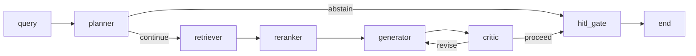

# EU AI Act & GDPR Assistant — a compliance copilot

Ask a question in plain language, get an answer where **every claim traces back to a
specific article or recital** — or an honest "I can't answer that from these sources."

**Live:** [ai-lab-web-ten.vercel.app](https://ai-lab-web-ten.vercel.app)

Runs end to end on free tiers. Total infrastructure cost: **$0**.

> **Evaluating me for a project?** The short version is in
> [docs/case-study.md](docs/case-study.md) — architecture, the three
> decisions with the numbers behind them, what it costs to run, and what it can't do. The
> rest of this README is the design document.

---

## Why abstention is the whole point

Most RAG demos answer everything you ask them. That's fine for a docs chatbot and
disqualifying for regulation, where a confident wrong answer about Article 35 is worse
than no answer at all — someone might act on it.

So the design target was never "answer more questions." It was: *when the retrieved text
doesn't actually support a confident answer, say so.* That one requirement drives
everything below — the critic node, the citation validator, the eval metrics, and the
decision to keep a reranker switched off.

Here's the system refusing, on a question it genuinely couldn't ground:

> **Who must appoint a data protection officer under GDPR?**
>
> *This system can't answer that faithfully.* The chunks provided do not contain the
> GDPR provision (Article 37(1)) that lists which controllers or processors must appoint
> a data protection officer. The available text covers group appointments,
> qualifications, staff/service contracts, and involvement, but not the mandatory
> appointment requirement.

That refusal is correct given what the generator was shown — and the diagnosis of *why*
it was shown the wrong five paragraphs is written up in
[Known gaps](#known-gaps-honestly). Both halves matter: the system didn't bluff, and the
failure was traceable to a specific ranking decision.

---

## How it works



Six LangGraph nodes, each one a pure function of typed state:

- **planner** — rewrites the question into a retrieval query, classifies intent, and can
  abstain immediately on out-of-scope questions before spending a single retrieval call.
- **retriever** — hybrid: pgvector cosine search and Postgres full-text search fused by
  reciprocal rank, with provisions the question names ("Article 5(1)", "Annex III point
  5") pinned first and guidance weighted below the law it interprets
  ([ADR 0007](docs/adr/0007-hybrid-retrieval-and-reference-pinning.md)).
- **reranker** — reorders and truncates to the top 5 chunks the generator will see.
- **generator** — answers from **only** those chunks, emitting structured output with a
  `citations` list and an `abstained` flag. Citations are validated against the real
  chunk ids in scope; invented ids are stripped, not trusted.
- **critic** — checks every claim against the chunks it cites and, on a failure, sends
  the draft back to the generator *with the unsupported claim named*, to be removed or
  corrected against the same chunks. (It used to re-run retrieval with an unchanged query,
  which returned the same chunks and repeated the same claim.) The loop has a hard
  iteration cap *and* a token budget guard; unbounded loops are treated as bugs.
- **hitl_gate** — pauses via LangGraph's `interrupt()` for human review when confidence
  is low **or the critic still rejects the draft at the cap** — the generator grading its
  own confidence can't overrule the critic. An answer that passes without review is
  marked `auto_approved`, never `human_approved`.

State is a single typed `AgentState`. Nodes never call each other — the runtime routes.
The checkpointer is Postgres-backed, so a thread survives a process restart, which
matters on ephemeral free-tier compute.

### The corpus

**2,457 chunks**, every one labelled with how much weight it carries
([ADR 0008](docs/adr/0008-authority-labelled-multi-source-corpus.md)):

| Authority | Source | Chunks |
|---|---|---:|
| binding | EU AI Act **as amended by Reg. (EU) 2026/1744** (EUR-Lex consolidation of 27 July 2026): 119 articles, 14 annexes, 180 recitals | 1,018 |
| binding | Reg. (EU) 2026/1744 (Digital Omnibus on AI): its 47 recitals | 47 |
| binding | GDPR (unamended): 99 articles, 173 recitals | 644 |
| guidance | 3 Commission guidelines (Art. 5 prohibitions, AI-system definition, GPAI scope), 5 EDPB guidelines/opinions, the EDPB-endorsed WP29 DPIA guidelines | 743 |
| status | dated, sourced notes on amendments adopted or pending | 5 |

Articles and annexes are chunked at whole-provision *and* paragraph/point grain; guidance
as runs of its own numbered paragraphs, cited "paras 26–28". Every source links back to
EUR-Lex or to the guidance PDF at the right page, and the UI says which sources are law
and which aren't. Embeddings are `BAAI/bge-small-en-v1.5` computed **locally on CPU** —
never a hosted embedding API. The ingest is idempotent and deletes provisions that no
longer exist, so re-running after an amendment is safe; status notes older than 90 days
are flagged at ingest.

### Every model call goes through one gateway

`packages/llm/gateway.py` is the only place in the codebase that may name a model. It
owns provider routing and fallback chains, retries with backoff, per-provider concurrency
limits, a semantic cache, budget enforcement, and telemetry. Nothing else imports a
provider SDK.

That single choke point is what made a bad afternoon survivable — see
[the Groq story](#decisions-worth-reading).

### Streaming contract

The API streams **typed node-level events** over SSE (`graph_started`, `node_started`,
`node_completed`, `graph_completed`). The event schema is generated from the Pydantic
models into TypeScript, so the frontend's graph visualisation can't silently drift from
the backend's contract. Each node reports its own latency and cost as it completes —
that's what the live graph on the demo is rendering.

---

## What the numbers say

The golden set has 85 items in two splits. **dev** (52) is what prompts, weights and
thresholds are tuned against; **test** (33) is held out, so its numbers are reported and
never tuned on. The original 37 items all live in dev. 30 of them name the article in the
question ("…according to Article 5"), which made retrieval look easier than it is. The
48 items added in October are phrased the way users ask, and include questions the
system *must* decline: CCPA, enforcement fines, UK law, Schrems II. Scorecards are
generated artifacts, not checked in; `just evals-generation` and `just evals-fast`
rewrite them into `evals/reports/`.

**Backtest on the held-out test split**, 2026-10-18. Baseline is `main` (2024 OJ text,
articles and recitals only, vector-only retrieval) re-ingested into its own database:

| Generation (Layer 3, 33 items) | baseline | now |
|---|---:|---:|
| answered or abstained correctly | 25/33 | **31/33** |
| false abstention (answerable, declined) | 27.6% | **6.9%** |
| false answer (must decline, answered) | 0% | 0% |
| citation validity | 0.962 | **0.988** |
| faithfulness ⚠️ | 0.965 | **0.989** |
| answer relevancy | **0.903** | 0.868 |
| context precision | **0.125** | 0.066 |

| Retrieval (29 scored items) | baseline | now |
|---|---:|---:|
| hit@1, containment-aware | 0.207 | **0.586** |
| hit@5, containment-aware | 0.586 | **0.793** |
| MRR@5, containment-aware | 0.371 | **0.659** |
| recall@5, strict | **0.342** | 0.172 |

"Containment-aware" counts a retrieved article or annex chunk as covering the paragraph
or point it holds verbatim. The strict metric falls because hybrid search returns the
whole provision where the label names one paragraph. Both are reported; see
[ADR 0007](docs/adr/0007-hybrid-retrieval-and-reference-pinning.md).

Two numbers went the wrong way and are kept visible on purpose. **Answer relevancy** fell
from 0.903 to 0.868. An earlier run of the same branch on the same split scored 0.918, so
judge noise is part of it, but answers that draw on law *and* guidance are longer, and
the relevancy judge penalises qualifications. **The faithfulness judge** (fast tier)
failed to return parseable JSON on 12 of 29 items against the longer article-level
contexts, so that mean covers 17 items. It needs a stronger judge tier before it can be
fully trusted.

On dev, after tuning: 52/52 correct abstention decisions, citation validity 1.000,
faithfulness 0.992, answer relevancy 0.924.

**About context precision.** It's the metric that looks broken, and it's the one I'd want
to be asked about. It's computed as an exact set intersection between the golden set's
`relevant_chunk_ids` and the chunk ids actually shown to the generator. Because the
corpus is chunked at *both* article and paragraph grain, the retriever legitimately
returns `article:35` and `article:35:paragraph:7` when the golden set names only one of
them — scored as a miss even though the generator saw exactly the right text.
[ADR 0006](docs/adr/0006-context-precision-and-chunk-grain.md) works through the
diagnosis. The honest summary: it's a measurement artifact, and it's documented rather
than quietly dropped from the scorecard.

**The judge is itself checked.** LLM-as-judge numbers are worthless if nobody audits the
judge, so `just evals-judge-agreement` emits a per-case report designed to be read by a
human before the aggregates are trusted — every verdict, its reasoning, and the cited
chunk text side by side.

---

## Decisions worth reading

Six [ADRs](docs/adr/) record the calls that shaped this. The interesting ones:

**[0003 — the reranker that got built, measured, and switched off.](docs/adr/0003-reranking-evaluated-and-deferred.md)**
A local cross-encoder was a stated requirement. It was built and unit-tested. Then it was
measured on the golden set and it made things *worse* — recall@3 dropped 0.967 → 0.933,
nDCG 0.834 → 0.781. So it ships disabled behind an identity passthrough, with the
evidence written down. Building the thing was easy; deleting it from the default path
took the eval harness.

**[0005 — a rate limit that wasn't a rate limit.](docs/adr/0005-deepseek-primary-groq-free-fallback.md)**
Eval runs kept dying against Groq even after waiting a full day. Reproducing the call
outside the gateway surfaced the real error body: a **tokens-per-minute** ceiling, not
the daily quota — a rolling 60-second window that waiting 24 hours does nothing for.
DeepSeek became primary, Groq the fallback. The fix was one registry change *because* all
routing lives behind the gateway.

**[0004 — `import ragas` doesn't.](docs/adr/0004-generation-eval-judge-via-deepeval-not-ragas.md)**
The planned eval library crashes on import against current `langchain-community`. Verified
against the current release, confirmed as a known open bug, switched the judge to
`deepeval`, kept ragas pinned-but-unused with the reason recorded.

---

## Running on $0

Cost discipline is a design constraint here, not a postscript.

- **Embeddings and reranking run on CPU, locally.** Never a hosted embedding API.
- **The demo's headline path costs nothing.** Example questions replay a cached golden
  trace client-side — they work even if the backend is paused, which also means a
  recruiter clicking around can't burn the budget.
- **Live queries are rate-limited per IP** and sit behind a global budget guard, so
  exhaustion degrades into a friendly in-band message instead of an error.
- **The production image was 8.75 GB before the CPU-only torch swap; 2.58 GB after.**
  The default torch wheel drags in several GB of CUDA libraries that a `device="cpu"`
  deployment never loads.

Deployed on Google Cloud Run (API, scale-to-zero on the always-free tier), Vercel (web),
Neon (Postgres + pgvector), Upstash (Redis). The first live query after an idle spell
pays a cold start, measured at ~80 s to first response (a 2.6 GB image pulled from GHCR,
then torch and the embedder loading on one vCPU). The landing page pings `/health` on
load, so the instance is usually booting while the visitor reads; cached example
questions never touch the API.

---

## Known gaps, honestly

**Open now:**

- **Annex IV doesn't surface for "what technical documentation must a provider draw
  up?".** Article 11 does, and its paragraph 1 points to Annex IV, but the annex itself
  ranks outside the top 20. Postgres full-text ranking has no IDF, so long provider
  articles that repeat "technical documentation" outrank the annex titled exactly that.
  Following a retrieved provision's cross-references to the annex it names is the next
  lever.
- **Answer relevancy fell on the test split** (0.903 → 0.868; see above), and the
  fast-tier faithfulness judge can't parse its own output on long contexts.
- **Status notes are hand-maintained.** They are dated and sourced, ingest warns at 90
  days, but nobody can re-fetch them.

**Fixed since:** `cand-041` below now passes. Hybrid retrieval returns Article 37 whole,
which contains 37(1), and the answer cites it. The history is kept because it is the best
argument in this repo for reading per-item numbers, not just means.

**The DPO question was a ranking failure, not a corpus gap.** Article 37(1) *is*
indexed. Cosine similarity ranks it **9th** for that query — the paragraphs of Articles
37 and 38 are so topically similar that the whole top-10 sits inside a 0.026 score band,
and `bge-small` can't separate them. The top-5 cut then drops the one paragraph that
answers "who must appoint."

The interesting part: re-running those same candidates through the disabled cross-encoder
moves Article 37(1) from **rank 9 to rank 2** — comfortably inside the cutoff. So the
component that would fix this query is the one the golden set says to leave off.

The trigger is narrower than it looks. The set already held the same question in the
statute's own vocabulary — *"when am I required to **designate** a DPO under Article 37"* —
which retrieves at rank 2. Dropping the article number changes nothing; swapping the verb
to **appoint** is what costs four ranks. It isn't a general vocabulary gap either:
everyday paraphrases of two other golden items ("privacy impact assessment", "data leak")
still rank 2nd and 1st. The failure needs *both* an everyday synonym and a dense cluster
of near-identical siblings competing for the same five slots.

So rather than flip a switch on one anecdote, the case went into the golden set as
`cand-041` and both configurations were re-run over 37 items:

| k | recall dense → rerank | nDCG dense → rerank |
|---:|---|---|
| 1 | 0.6290 → 0.5323 | 0.6452 → 0.5484 |
| 3 | 0.9355 → 0.9355 | 0.8072 → 0.7757 |
| 5 | 0.9677 → 0.9355 | 0.8197 → 0.7757 |
| 10 | 1.0000 → 0.9355 | 0.8294 → 0.7757 |

**The reranker stays off.** It loses on every metric except a tie at recall@3 — *with the
case that motivated the revisit now in the set.* It fixes `cand-041` and breaks more than
it fixes ([ADR 0003 addendum](docs/adr/0003-reranking-evaluated-and-deferred.md)).

### The part worth reading twice

`cand-041` also caught the generator doing something worse than failing. Two Layer 3 runs,
same retrieval, differing only in the generator's system prompt:

| run | abstained? | faithfulness | citation validity | **context precision** |
|---|---|---|---|---|
| before prompt hardening | no | 1.0 | 1.0 | **0.0** |
| after | yes | — | 0.0 | **0.0** |

`context_precision = 0.0` in *both*: Article 37(1) was never among the five chunks shown.
So in the first run the model answered "who must appoint a DPO" from the *neighbouring*
paragraphs — group appointments, qualifications, contracts — and scored a **flawless 1.0
on faithfulness, relevancy, and citation validity**. Every headline metric said the answer
was perfect. It was faithful to text that doesn't answer the question.

The only number that dissented was `context_precision`, the metric flagged above as a
measurement artifact. On average it *is* an artifact of dual-grain chunking. But a **0.0**
on a single item isn't grain — it means nothing relevant was retrieved at all, and the
mean hides that completely.

After hardening, the model abstains instead, which the abstention metric scores as a
*failure*. That trade — a worse-looking scorecard for honest behaviour — is the one this
project exists to make. `cand-041` was left failing on purpose, to mark the boundary of
what that retrieval stack handled, until a retrieval change (not a prompt change) fixed it.

**Also deferred:** token-by-token answer streaming (the contract streams node-level
events; true token streaming needs its own ADR covering cache/retry/budget interactions),
and Layer 4 of the eval harness.

---

## Layout

```
apps/api        FastAPI + LangGraph runtime
apps/web        Next.js, AI SDK v6, streaming UI
apps/ingest     corpus pipeline CLI
packages/core   domain types + Protocols, zero I/O
packages/llm    the gateway — single entry point to any model
packages/retrieval  pgvector, embedders, rerankers
packages/evals  datasets, metrics, runners
docs/adr        architecture decision records
```

`packages/core` defines `Protocol` classes and imports no adapters; dependency arrows
point inward. Pydantic v2 models cross every module boundary — no bare dicts, no regex
parsing of model output.

```bash
just dev           # postgres + redis, then api and web
just test          # 251 fast deterministic tests
just evals-fast    # layers 1+2, deterministic, free
just ingest        # rebuild the corpus index
```

Deployment is documented in [docs/PRODUCTION_DEPLOY.md](docs/PRODUCTION_DEPLOY.md).
